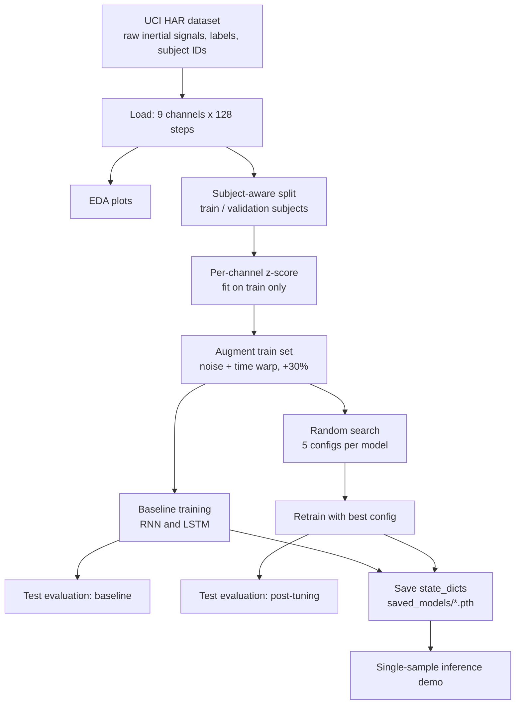

# Human Activity Recognition (UCI HAR) with RNN and LSTM

A PyTorch project that classifies human physical activity from smartphone inertial sensor signals. A single Jupyter/Colab notebook (`main.ipynb`) loads the UCI HAR dataset, explores it, builds a subject-aware train/validation split, augments the training data, trains bidirectional **RNN** and **LSTM** classifiers, tunes hyperparameters, retrains the best configurations, evaluates them on the official test set, and includes a single-sample inference demo.

## Table of Contents

- [Overview](#overview)
- [Features](#features)
- [Technology Stack](#technology-stack)
- [System Architecture](#system-architecture)
- [Repository Structure](#repository-structure)
- [Prerequisites](#prerequisites)
- [Installation and Setup](#installation-and-setup)
- [Configuration](#configuration)
- [How to Run](#how-to-run)
- [Usage Guide](#usage-guide)
- [Data](#data)
- [Models](#models)
- [Training Pipeline](#training-pipeline)
- [Results](#results)
- [Outputs Produced by the Notebook](#outputs-produced-by-the-notebook)
- [Testing](#testing)
- [Troubleshooting](#troubleshooting)
- [Limitations](#limitations)
- [Future Improvements](#future-improvements)
- [Contributing](#contributing)

## Overview

**Problem:** recognizing what a person is doing (walking, sitting, lying, and so on) from wearable sensor data is useful for health monitoring, fitness tracking, and context-aware applications.

**Task:** given a 2.56-second window of 9 inertial sensor channels (128 time steps), predict one of 6 activities:

| Label index | Activity |
|-------------|----------|
| 0 | WALKING |
| 1 | WALKING_UPSTAIRS |
| 2 | WALKING_DOWNSTAIRS |
| 3 | SITTING |
| 4 | STANDING |
| 5 | LAYING |

**Intended users:** students and practitioners learning time-series classification with recurrent networks in PyTorch.

**What the notebook compares:** a vanilla bidirectional RNN versus a bidirectional LSTM, each as a baseline and after hyperparameter tuning, evaluated on the held-out test subjects.

## Features

- **Subject-aware validation split:** whole subjects, not random windows, are held out for validation to avoid leakage between a person's samples.
- **Exploratory data analysis:** class distribution, sensor waveforms, channel correlations, per-subject activity counts, feature histograms, and time-series comparisons.
- **Per-channel z-score normalization** fitted on training data only.
- **Training-set augmentation:** Gaussian noise and time warping applied to a random 30% subset, which is appended to the training data.
- **Two architectures:** bidirectional RNN and bidirectional LSTM with mean pooling over time, layer normalization, and dropout.
- **Training utilities:** Adam with weight decay, gradient clipping (max norm 1.0), `ReduceLROnPlateau`, and a custom early-stopping class that restores the best weights.
- **Randomized hyperparameter search:** 5 randomly sampled configurations per architecture.
- **Evaluation:** accuracy, macro F1, per-class classification report, normalized confusion matrices, and per-class F1 charts.
- **Inference demo:** pick a test sample number and see predictions and class probabilities from all four trained models.
- **Reproducibility settings:** seed 42 is set for Python, NumPy, and PyTorch.

## Technology Stack

| Technology | Purpose |
|------------|---------|
| Python | Language |
| PyTorch | Models, training loops, data loaders |
| NumPy, pandas | Array handling, tabular tuning results |
| scikit-learn | `StandardScaler`, metrics (accuracy, macro F1, confusion matrix, classification report) |
| matplotlib, seaborn | Plots |
| Google Colab and Google Drive | The notebook's intended runtime and data location (GPU type T4 in the notebook metadata) |

The versions printed by the saved notebook run were: Python 3.12.13, PyTorch 2.11.0+cu128, NumPy 2.0.2, pandas 2.2.2, scikit-learn 1.6.1, Matplotlib 3.10.0, Seaborn 0.13.2. The repository does not pin versions in a requirements file.

## System Architecture

The project is a linear experiment pipeline inside one notebook; there is no server or API.



## Repository Structure

```text
human-activity-recognition/
├── main.ipynb    # Entire pipeline: data loading, EDA, training, tuning, evaluation, demo
└── README.md     # Original one-line title; replace with this document
```

`main.ipynb` is organized into these sections (markdown headings in the notebook): Imports and Configuration, Dataset Loading, Exploratory Data Analysis, Data Preprocessing, Model Architecture, Model Training, Baseline Model Evaluation, Hyperparameter Tuning, Post-Tuning Model Evaluation, and Demo. The committed notebook includes its saved outputs, including 17 embedded figures.

## Prerequisites

- **Recommended:** a Google account and Google Colab with a GPU runtime (the saved run used CUDA). A CPU also works; the code selects the device automatically.
- **For local use:** Python 3 with `torch`, `numpy`, `pandas`, `scikit-learn`, `matplotlib`, `seaborn`, and `jupyter`.
- The **UCI HAR dataset** ("Human Activity Recognition Using Smartphones" from the UCI Machine Learning Repository), unzipped to a folder named `UCI-HAR-Dataset`. It is not included in this repository.

## Installation and Setup

### Option A: Google Colab (matches the notebook as written)

1. Download and unzip the UCI HAR dataset.
2. Upload the folder to Google Drive as `MyDrive/UCI-HAR-Dataset`.
3. Open `main.ipynb` in Colab (upload it, or open it from GitHub) and choose a GPU runtime (**Runtime > Change runtime type**).

### Option B: local machine

```bash
git clone https://github.com/vanessaserenina/human-activity-recognition.git
cd human-activity-recognition

python -m venv .venv
source .venv/bin/activate          # Windows: .venv\Scripts\activate

pip install torch numpy pandas scikit-learn matplotlib seaborn jupyter
jupyter notebook main.ipynb
```

For a local run, make two edits in the notebook (see [Configuration](#configuration)): skip the Google Drive mounting cell, and set `dataset_path` to your local `UCI-HAR-Dataset` folder.

The expected dataset layout (taken from the loading code):

```text
UCI-HAR-Dataset/
├── train/
│   ├── Inertial Signals/
│   │   ├── body_acc_{x,y,z}_train.txt
│   │   ├── body_gyro_{x,y,z}_train.txt
│   │   └── total_acc_{x,y,z}_train.txt
│   ├── X_train.txt
│   ├── y_train.txt
│   └── subject_train.txt
└── test/
    └── (same files with the suffix _test)
```

## Configuration

There are no environment variables or config files. Settings live in the `configuration` dictionary and a few variables in the notebook:

| Setting | Location | Value |
|---------|----------|-------|
| `SEED` | Imports cell | `42` |
| `n_timesteps` / `n_channels` / `n_classes` | `configuration` | `128` / `9` / `6` |
| `val_split` | `configuration` | `0.15` (fraction of training subjects held out) |
| `hidden_units` | `configuration` | `32` |
| `n_layers` | `configuration` | `2` |
| `dropout_rate` | `configuration` | `0.5` |
| `batch_size` | `configuration` | `64` |
| `epochs` | `configuration` | `50` (maximum) |
| `learning_rate` | `configuration` | `1e-4` |
| `tuning_epochs` | `configuration` | `30` |
| `dataset_path` | Dataset Loading cell | `/content/drive/MyDrive/UCI-HAR-Dataset` (change for local use) |
| `MAX_COMBOS` | Hyperparameter Search Grid cell | `5` random configurations per architecture |

Fixed in code: weight decay `1e-3` in the model builders, gradient clipping max norm `1.0`, `ReduceLROnPlateau(factor=0.5, patience=3)` in baseline training, and early stopping on validation loss (patience 10 for baseline and post-tuning runs, patience 3 for tuning runs).

## How to Run

1. Open the notebook in Colab or Jupyter.
2. Run all cells from top to bottom (**Runtime > Run all** in Colab). Run order matters because later cells reuse earlier variables.
3. The last cell is interactive: it asks for a sample number between 1 and 2947 (a test-set index, 1-based).

Training time in the saved run, on a GPU: about 34 seconds for the baseline RNN and 37 seconds for the baseline LSTM. The tuning loop and post-tuning retraining add to that.

## Usage Guide

| Goal | What to do |
|------|------------|
| Reproduce the experiment | Run all cells in order. |
| Change baseline settings | Edit the `configuration` dictionary and re-run from the Imports cell. |
| Widen the tuning search | Raise `MAX_COMBOS` or edit `TUNING_GRID` (learning rate, hidden units, layers, dropout, batch size, weight decay). |
| Run a prediction | Run the demo cell, enter a number from 1 to 2947, and read the predicted activity, confidence, and ranked class probabilities for each of the four models. |
| Reload a trained model | `model = LSTMModel(...)` (or `RNNModel`) with the same constructor arguments, then `model.load_state_dict(torch.load('saved_models/lstm_post_model.pth'))` and `model.eval()`. Inputs must be z-scored with the training-set scaler. |

The inference demo prints a summary like this for each model (format only; values depend on the sample you choose):

```text
  Model                      Prediction             Conf   Verdict
  RNN  (Baseline)            <ACTIVITY>             <xx.x>%   CORRECT / INCORRECT
  ...
  Models correct: <n> / 4
  Consensus     : All 4 models agree / Models disagree
```

## Data

**Source:** UCI HAR dataset (smartphone accelerometer and gyroscope recordings of volunteers performing six activities). The notebook uses two representations:

1. **Raw inertial signals (used by the models):** 9 channels (`body_acc_x/y/z`, `body_gyro_x/y/z`, `total_acc_x/y/z`) of 128 time steps per window.
2. **561 engineered features (used only for exploratory plots):** loaded and visualized in Plot 5 but not used for training.

**Sizes reported in the saved notebook run:**

| Set | Samples | Subjects |
|-----|---------|----------|
| Original training split | 7,352 | 21 |
| Test split | 2,947 | 9 (subjects 2, 4, 9, 10, 12, 13, 18, 20, 24) |
| Training after subject-aware split | 6,281 | 18 |
| Validation | 1,071 | 3 (subjects 3, 22, 25) |
| Training after augmentation | 8,165 | 18 (6,281 original + 1,884 augmented) |

Normalization statistics are computed from the 6,281 training samples and applied to validation and test data.

## Models

Both networks share the same structure. With `H` hidden units:

```text
input (batch, 128, 9)
  -> input dropout
  -> bidirectional recurrent layer(s)    (nn.RNN with tanh, or nn.LSTM)
  -> mean over time steps                (output size 2H)
  -> LayerNorm -> dropout
  -> Linear(2H, 128) -> ReLU -> dropout
  -> Linear(128, 6)                      (class logits)
```

The loss is `CrossEntropyLoss`. The optimizer is Adam with weight decay `1e-3` unless the tuning loop overrides it.

## Training Pipeline

1. **Load** raw signals, labels (converted from 1-6 to 0-5), and subject IDs.
2. **Split:** about 15% of training subjects (3 of 21) are chosen at random (seeded) as the validation set.
3. **Normalize** each channel with a `StandardScaler` fitted on the training windows only.
4. **Augment** the training set: 30% of samples are copied; half of the copies get Gaussian noise (std 0.02), the other half get time warping (up to ±5% cumulative distortion). Copies are appended to the originals.
5. **Baseline training:** each model is trained for up to 50 epochs with early stopping on validation loss.
6. **Tuning:** 5 random configurations from the grid are trained for each architecture (up to 30 epochs, early-stopping patience 3). Each configuration is scored by the mean validation loss and macro F1 of its last three epochs.
7. **Retraining:** the configuration with the highest validation macro F1 is selected per architecture, and a new model is trained from scratch with it. The retraining step uses the selected learning rate, hidden units, and dropout rate, with a batch size of 128 and the model builders' default layer count (2) and weight decay (`1e-3`); no learning-rate scheduler is used.
8. **Evaluate** on the 2,947-sample test set; the test set is not used for any selection decision in the notebook code.
9. **Save** the four models' `state_dict`s and run the demo.

Selected configurations (from the saved run):

| Model | Learning rate | Hidden units | Dropout | Batch size |
|-------|---------------|--------------|---------|------------|
| RNN | 0.0005 | 128 | 0.4 | 128 |
| LSTM | 0.0005 | 128 | 0.5 | 128 |

## Results

Test-set results printed in the committed notebook output (2,947 samples; the notebook was not re-run for this README):

| Model | Accuracy | Macro F1 |
|-------|----------|----------|
| RNN (baseline) | 0.8958 | 0.8950 |
| LSTM (baseline) | 0.9006 | 0.8998 |
| RNN (post-tuning) | 0.9169 | 0.9165 |
| LSTM (post-tuning) | 0.9111 | 0.9109 |

Per-class F1 on the test set (post-tuning):

| Activity | RNN | LSTM |
|----------|-----|------|
| WALKING | 0.9461 | 0.9920 |
| WALKING_UPSTAIRS | 0.9154 | 0.9442 |
| WALKING_DOWNSTAIRS | 0.9610 | 0.9483 |
| SITTING | 0.8162 | 0.7644 |
| STANDING | 0.8625 | 0.8215 |
| LAYING | 0.9981 | 0.9954 |

**How to read them:** both models separate dynamic activities (walking variants) and LAYING well. SITTING and STANDING are the hardest classes for both architectures, with F1 between roughly 0.76 and 0.86. These figures come from a single training run with seed 42; results can differ across hardware and library versions, so treat small gaps between models as indicative rather than conclusive.

## Outputs Produced by the Notebook

| Path (created in the working directory) | Contents |
|------------------------------------------|----------|
| `figures/*.png` | Saved EDA, training-curve, confusion-matrix, and tuning plots |
| `saved_models/rnn_baseline_model.pth`, `lstm_baseline_model.pth`, `rnn_post_model.pth`, `lstm_post_model.pth` | Model weights (`state_dict`) |
| `best_RNN.pt`, `best_LSTM.pt` | Best weights from each tuning loop (lowest stable validation loss) |
| `checkpoints/` | Empty directory created by the early-stopping helper |

In Colab these are written to the temporary session storage, so download or copy them to Drive before the session ends.

## Testing

The repository has no automated tests, test framework, or CI configuration. Quality is assessed through validation and test metrics inside the notebook. The code cells in `main.ipynb` were checked to be syntactically valid Python, but the full notebook was not re-executed for this README because the dataset is not part of the repository.

## Troubleshooting

| Symptom | Likely cause and fix |
|---------|----------------------|
| `ModuleNotFoundError: No module named 'google.colab'` | You are running locally. Remove the Drive-mounting cell. |
| `NameError` for `X_train_raw` or `data_source` is `None` / file not found | `dataset_path` is wrong or the dataset layout differs. Point it to the folder containing `train/` and `test/`. |
| `NameError: name 'F' is not defined` in the demo cell | The demo uses `F.softmax`; add `import torch.nn.functional as F` to the imports cell and re-run it. |
| `NameError` for variables such as `rnn_model` or `df_tuning` | Cells were run out of order. Use **Run all** from the top. |
| Training is slow | Use a GPU runtime; on CPU, reduce `epochs`, `tuning_epochs`, or `MAX_COMBOS`. |
| CUDA out-of-memory | Lower the batch size or hidden units, or switch to CPU. |
| Results differ slightly from the tables above | Different hardware, CUDA, or library versions can change floating-point results even with fixed seeds. |
| Saved weights fail to load | Rebuild the model with the same `hidden_units`, `n_layers`, and `dropout_rate` used for that file before calling `load_state_dict`. |

## Limitations

- The whole project is a single notebook; there is no installable package, command-line interface, or API.
- No requirements file pins library versions; data location is hard-coded for Google Drive.
- The validation set contains only 3 subjects, so validation scores (and therefore model selection) are noisy.
- The hyperparameter search samples only 5 configurations per architecture from a grid of 1,152 combinations.
- The notebook's pipeline description says retraining uses the combined training and validation subjects, but the retraining code uses the augmented training subjects only (8,165 samples) and keeps the validation subjects for early stopping.
- Tuned values for the number of layers and weight decay are recorded in the tuning results but are not passed to the retraining models, which use the builder defaults.
- Results come from one seed and one run; no cross-validation across subjects or confidence intervals are reported.
- The 561 engineered features are loaded for exploration only and are not used in modeling.
- Only the notebook's saved outputs document the reported results; the inference demo cell has no saved output.
- Model weights are saved with `torch.save` of the `state_dict` and loaded with `torch.load`; only load weight files from sources you trust.

## Future Improvements

These are suggestions, not existing features:

- Add a `requirements.txt` (or `environment.yml`) and make the dataset path configurable.
- Move the code into scripts or a package (data loading, models, training, evaluation) and keep the notebook for exploration.
- Use leave-subjects-out cross-validation and report mean and spread across several seeds.
- Pass the tuned layer count and weight decay into retraining, and consider training the final model on train plus validation subjects.
- Try 1D CNN, CNN-LSTM, or Transformer baselines and compare against the 561-feature classical models.
- Address the SITTING/STANDING confusion, for example with longer windows or additional features.
- Export a model for real-time inference (TorchScript or ONNX) and add a small demo app.
- Add a license file (none is present).

## Contributing

1. Fork the repository and create a branch: `git checkout -b feature/short-description`.
2. Make your changes in the notebook (or in new scripts) and run the notebook top to bottom before committing.
3. Clear or refresh notebook outputs deliberately so that reported metrics match the code.
4. Commit with a clear message and open a pull request describing what changed and how you checked it.

## License

No license file is present in the repository.
